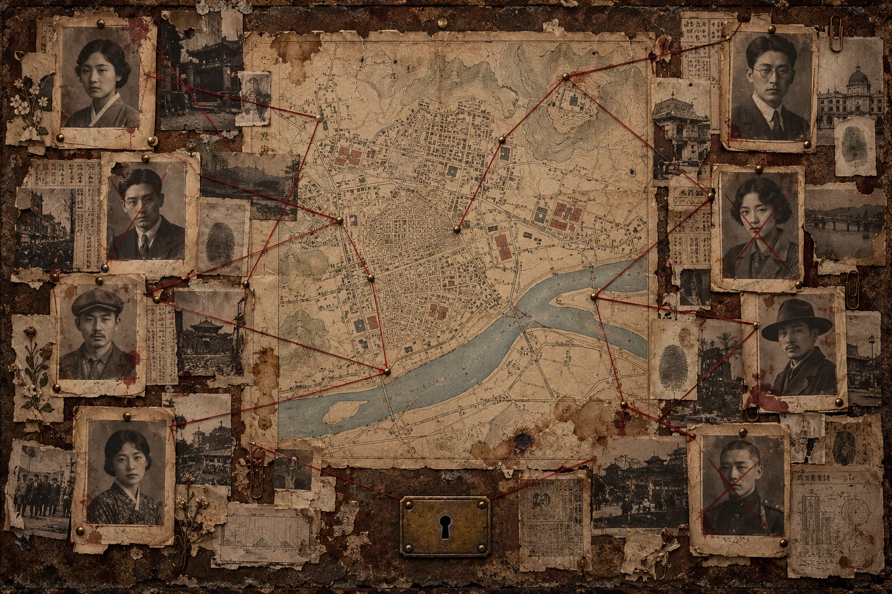
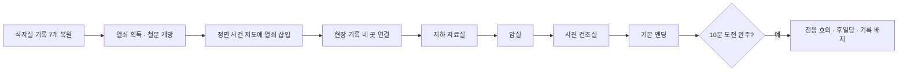
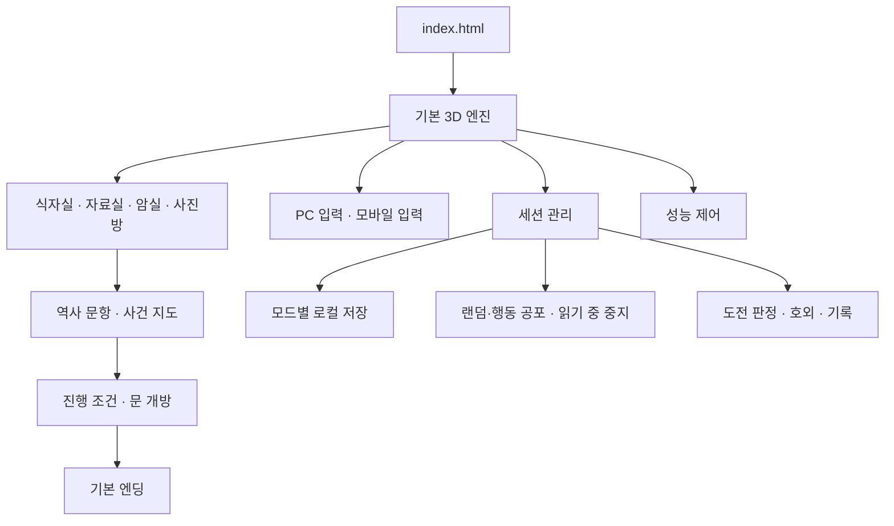

<div align="center">

# 📰 경성야록 · 경성 활판 인쇄소

**1934년 경성의 인쇄소에서, 사라진 사람들의 기록을 되찾는 1인칭 공포·역사 퍼즐 게임**

탐색하고, 읽고, 연결하고, 마지막 지면을 복원하세요.

[🎮 게임 실행](https://gyeongseong-game-min8309.minsunpark3421.chatgpt.site) · [📦 소스 ZIP 다운로드](https://github.com/Min8309/game_01/archive/refs/heads/main.zip) · [🐛 오류 제보](https://github.com/Min8309/game_01/issues)



</div>

## 💡 어떤 게임인가요?

깊은 밤, 식자공들이 사라진 인쇄소에 들어갑니다. 멈춘 괘종시계, 낡은 서랍, 검열된 교정지와 붉은 실로 연결된 사건 지도에서 단서를 찾아 지하 자료실과 암실로 나아갑니다.

웹 브라우저에서 바로 플레이하며, **PC와 모바일에서 같은 공간·같은 퍼즐**을 사용합니다. 기본 모드는 시간제한 없는 **자유 탐색**입니다. 더 긴장감 있는 플레이를 원하면 보상이 있는 **10분 도전**을 선택할 수 있습니다.

### 기획 의도

- **읽는 행위가 곧 플레이가 되는 게임:** 단서를 빨리 넘기는 대신, 기록의 출처·인물의 역할·시간의 순서를 읽고 판단하도록 구성했습니다.
- **역사와 미스터리의 연결:** 활판 인쇄, 신문, 문학, 보도사진을 공간 속 소품과 퍼즐로 만납니다.
- **선택할 수 있는 긴장감:** 자유 탐색에서는 천천히 읽고, 도전 모드에서는 제한시간과 특별 보상을 목표로 플레이합니다.
- **행동에 반응하는 공포:** 자유 탐색에서는 시간제한 없이 랜덤 간격으로 귀신이 등장하며, 열쇠·서랍·지도 연결 같은 행동도 출현을 앞당깁니다. 여섯 이미지를 섞어 천장·바닥·복도·책상 아래 등에서 작게 등장하고 0.5초 만에 중앙으로 커진 뒤 사라집니다. 기록을 읽는 동안은 팝업과 발소리를 멈추며, 엔딩 뒤에는 출현하지 않습니다.

시간이 뒤틀린 1934년의 식자실에 1936년·1942년의 미래 기록까지 흘러든 창작 설정입니다. 각 자료는 해당 기록에 적힌 연도를 기준으로 읽습니다. 역사 문항과 창작 공포 사건은 구분합니다. **사건 조사벽의 인물·실종·피살 사건은 창작이며, AI 생성 사진을 실제 피해자 사진으로 제시하지 않습니다.** 갑작스러운 이미지·점멸·공포 음향이 포함됩니다.

## 🚀 실행·다운로드·설치

| 종류 | 제공 방식 | 시작하기 |
| --- | --- | --- |
| **웹 플레이** | 브라우저에서 실행 | [게임 열기](https://gyeongseong-game-min8309.minsunpark3421.chatgpt.site) |
| **PC 설치** | Chrome·Edge의 웹앱(PWA) 설치 | 게임 첫 화면의 **앱 설치 · PC / 모바일** 선택 |
| **안드로이드** | Chrome 웹앱 설치·홈 화면 추가 | Chrome 메뉴 **⋮ → 앱 설치 / 홈 화면에 추가** |
| **아이폰·아이패드** | Safari 홈 화면 추가 | Safari의 **공유 → 홈 화면에 추가 → 추가** |
| **개발용 소스** | 저장소 전체 ZIP | [main.zip 다운로드](https://github.com/Min8309/game_01/archive/refs/heads/main.zip) |

**현재 설치 방식은 PWA입니다. Windows `.exe`, Android `.apk`, 앱스토어용 설치 파일은 제공하지 않습니다.** 소스 ZIP은 설치 프로그램이 아니며, 직접 실행하려면 아래 로컬 서버 안내를 따라 주세요.

현재 테스트 사이트는 **소유자 전용 배포**입니다. 해당 ChatGPT 계정 로그인이 필요하며, 다른 사용자에게 웹 주소를 공유하려면 사이트의 접근 권한을 별도로 변경해야 합니다. GitHub 소스 다운로드와 로컬 실행은 이 배포 권한과 별개입니다.

### ⚡ 3단계로 시작하기

1. 게임 주소를 PC의 Chrome·Edge 또는 휴대전화의 Chrome·Safari에서 엽니다.
2. **자유 탐색 / 10분 도전**을 고르고, **새로 시작** 또는 **이어하기**를 선택합니다.
3. 화면의 다음 조사 목표를 따라 이동하고, 물체를 조사해 기록을 복원합니다.

### 📱 모바일 버전 안내

- 별도 축약판이 아니라 PC와 같은 게임입니다.
- 왼쪽 조이스틱으로 이동하고, 화면을 드래그해 시선을 돌립니다.
- 오른쪽 **픽업 · 조사**, **수첩**, **손전등**, **집중**, **음향** 버튼을 사용합니다.
- 공간 탐색은 **가로 화면을 권장**하며, 사건 지도는 세로 화면에서도 조작할 수 있습니다.
- 카카오톡 등 앱 안의 브라우저에서 설치 메뉴가 보이지 않으면 Chrome 또는 Safari에서 다시 여세요.

### 오프라인 플레이

처음에는 인터넷에 연결해 게임 파일이 저장될 때까지 기다려 주세요. 설치 안내의 **오프라인 실행 파일 준비 완료** 표시 후에는 저장된 파일로 실행할 수 있습니다. 업데이트를 받으려면 인터넷에 연결한 상태에서 새로고침하세요. 오프라인 준비가 끝나기 전이거나 브라우저가 저장 파일을 삭제한 경우에는 다시 연결해야 합니다.

## 🧭 두 가지 플레이 모드

| 항목 | 자유 탐색 · 기본 | 10분 도전 |
| --- | --- | --- |
| 제한시간 | 없음 | 10분 |
| 시간 초과 종료 | 없음 | 있음 |
| 화면 안내 | 복원 기록 `8 / 14`와 다음 목표 | 남은 시간과 복원 기록 |
| 자동 저장·이어하기 | 지원 | 지원, 기존 제한시간 유지 |
| 퀴즈·수첩 읽기 | 팝업·발소리 중지 | 팝업·발소리 중지, 시간은 계속 진행 |
| 본편 이야기·기본 엔딩 | 전부 제공 | 전부 제공 |
| 도전 전용 보상 | 없음 | 조건 달성 시 제공 |

난이도 **상** 문항은 기사와 소설의 증거 구분, 중복 명단과 정정표의 집계, 판결·목격담·수사 기록의 대조로 구성됩니다. 연습용 명단의 숫자와 편집 자료는 창작이며 실제 피해 통계·판결문 인용이 아닙니다. 읽은 단서는 답을 고르기 전에도 수첩에 보관됩니다.

10분 도전은 **게임 종료·백그라운드·다시 접속하는 시간도 포함**합니다. 이어하기로 제한시간이 새로 시작되지는 않습니다. 기록을 여유롭게 읽고 싶다면 자유 탐색을 선택하세요. 자유 탐색의 랜덤 출현은 10분이 지나도 끝나지 않습니다.

자료실에서는 뒤쪽 선반의 **흰 서류뭉치 ①·②**를 가까이 겨냥하세요. 초록색으로 위치가 강조되며, PC 클릭 또는 모바일 **픽업 · 조사**로 해당 퀴즈가 열립니다. 떠 있는 안내판이나 중앙 책상은 퀴즈 대상이 아닙니다.

### 🎁 도전 보상 조건

| 보상 | 조건 | 보관·확인 |
| --- | --- | --- |
| **한정 호외 PNG 카드** | 10분 안에 14개 기록 모두 복원 | 완료 화면에서 이름·완료 시간·복원 수를 담아 저장 |
| **도전 완주 후일담** | 위 완주 조건 달성 | 완료 화면의 추가 후일담 펼치기 |
| **10분 내 사건 해결 배지** | 도전 완주 | 다음 실행의 시작 화면에 표시 |
| **최고 기록** | 도전 완주 | 같은 브라우저의 기존 기록보다 빠르면 갱신 |
| **무힌트 기록관 칭호** | 도전 완주 + 명시적 힌트 버튼 미사용 | 완료 화면·호외 카드·시작 화면 |

오답은 다시 시도할 수 있습니다. 수사 기록과 단서 읽기는 퍼즐 풀이의 일부입니다. 도전 모드의 수첩에는 자동으로 추가 힌트를 노출하지 않습니다. 기록과 배지는 **해당 브라우저에 보관하는 개인 기록**이며 온라인 순위표가 아닙니다.

## 🗝️ 공간과 진행 구조

| 구역 | 주요 플레이 | 필수 기록 |
| --- | --- | --- |
| **1층 식자실·복도** | 달력, 괘종시계, 24번 서랍, 교정지, 포스터, 캐비닛, 책 조사 | 7개 |
| **1층 미제사건 조사실** | 정면 사건 지도에 열쇠 삽입 후 현장 경로 연결 | 1개 |
| **지하 자료실** | 선반의 흰 서류뭉치 ①·②에서 우리말 기록과 가상 명단 대조 퀴즈 조사 | 2개 |
| **암실** | 손기정 보도사진의 역사적 맥락 읽기 | 1개 |
| **사진 건조실** | 사진과 문학·보도·판결 기록 해석 | 3개 |
| **합계** | 모든 기록 복원 후 마지막 사진과 기본 엔딩 | **14개** |



### 사건 조사실의 특징

정면 벽 한 곳에 지도·인물 사진·붉은 실을 배치하고, 양옆은 낡은 콘크리트 벽으로 구성했습니다. 밖에서 얻은 열쇠를 책상에 올려놓는 대신 **지도 잠금장치에 직접 삽입**합니다. 열쇠를 넣는 것만으로 지하실이 열리지는 않습니다. 수사 기록을 읽고 올바른 경로를 연결해야 합니다.

캐비닛의 역할표는 **세 번째 서랍 안쪽 종이 더미 위**에 있습니다. 서랍을 열고 가까이에서 내려다보며 조사하세요.

## 🎮 조작 방법

| 동작 | PC | 모바일 |
| --- | --- | --- |
| 이동 | `W A S D` | 왼쪽 조이스틱 |
| 시점 전환 | 마우스 | 화면 드래그 |
| 조사·픽업 | 대상 조준 후 클릭 | 픽업 · 조사 버튼 |
| 확대·집중 | 마우스 우클릭 | 집중 버튼 |
| 달리기 | `Shift` | 별도 달리기 버튼 없음 |
| 수첩 | `N` | 수첩 버튼 |
| 손전등 | `F` | 손전등 버튼 |
| 음향 켜기·끄기 | `M` | 음향 버튼 |
| 조사창·수첩 닫기 | `Esc` 또는 닫기 | 닫기 버튼 |

PC에서 시선 조작을 시작하면 마우스가 게임 화면에 고정됩니다. `Esc`로 해제할 수 있습니다. 조사 가능한 물체를 가까이 바라보면 안내가 나타납니다.

## 💾 저장과 이어하기

- 자유 탐색과 도전은 **서로 다른 저장 슬롯**을 사용합니다.
- 단서, 소지품, 서랍, 열쇠 삽입, 지도 연결, 문·커튼, 사진 퍼즐과 위치를 저장합니다.
- 중요한 행동 뒤와 주기적인 저장 시점, 화면을 떠날 때 진행을 보관합니다.
- **이어하기**는 저장된 모드의 진행을 복원합니다. **새로 시작**은 해당 모드의 이전 진행을 초기화합니다.
- 클라우드 동기화는 없습니다. 다른 기기·브라우저·사이트 주소에서는 저장이 자동으로 공유되지 않습니다.
- 사이트 데이터를 삭제하면 진행과 개인 기록도 사라질 수 있습니다. 저장 공간을 사용할 수 없으면 화면에 안내합니다.

## ❓ 자주 묻는 질문

**10분이 너무 짧아요.**  
기본값인 자유 탐색을 사용하세요. 시간제한과 시간 초과 사망이 없으며 본편을 끝까지 볼 수 있습니다.

**설치했는데 인터넷이 필요한가요?**  
첫 실행과 업데이트에는 연결이 필요합니다. 오프라인 파일 준비가 완료된 뒤에는 저장된 게임을 사용할 수 있습니다.

**아이폰용 APK를 받아야 하나요?**  
현재는 Safari에서 홈 화면에 추가하는 PWA 방식입니다. APK는 제공하지 않으며 아이폰 설치 파일도 아닙니다.

**열쇠를 얻었는데 지하실이 열리지 않아요.**  
식자실의 필수 기록을 완료한 뒤, 미제사건 조사실 정면 지도에 열쇠를 삽입하고 경로 퍼즐까지 해결해야 합니다.

**게임을 다시 열었더니 도전 시간이 줄었어요.**  
도전은 실제 시작 시각을 기준으로 계산합니다. 종료·백그라운드 시간도 포함됩니다.

**화면이 끊기거나 느려요.**  
최신 Chrome·Edge에서 실행하고 브라우저의 그래픽 가속 설정을 확인해 주세요. 다른 무거운 탭·프로그램을 닫고 다시 실행해 보세요. 오류를 제보할 때 PC 사양, 브라우저, 설치 앱 여부와 끊기는 장소·행동을 함께 알려 주시면 확인에 도움이 됩니다. 모든 기기에서 동일한 프레임 속도를 보장하지는 않습니다.

**사진과 사건은 실제 기록인가요?**  
사건 조사벽의 인물과 사건은 창작이며 사진은 AI 생성 소품입니다. 실제 역사 자료의 해석을 다루는 문항과 구분해서 구성했습니다.

<details>
<summary><b>🛠️ 개발자용 구조·실행·확장 안내</b></summary>

### 프로젝트 구조

```text
game_01/
├── README.md                    # 게임 소개·설치·진행 안내
├── index.html                   # 시작 화면·HUD·게임 스크립트 진입점
├── manifest.webmanifest         # PC·모바일 PWA 설치 정보
├── pwa-install.js               # 기기별 설치 안내
├── game-pwa-sw.js               # 게임 파일 캐시·오프라인 실행
├── assets/
│   ├── game-classic.js          # Three.js 기반 기본 공간·이동·조사 실행 번들
│   ├── performance-controls.js  # 검색 제한·그래픽 품질·조명·렌더링 제어
│   ├── ghost-director.js        # 크리쳐 출현·애니메이션
│   ├── ghost-audio.js           # 팝업 음원 선택·중복 방지·음소거
│   ├── mobile-controls.js       # 조이스틱·터치 시선·조사 보조
│   ├── quest-navigator.js       # 다음 목표·복원 기록 표시
│   ├── case-map/               # 사건 조사벽 이미지
│   ├── ghosts/                 # 크리쳐 이미지
│   └── fonts/                  # 게임 글꼴과 폰트 라이선스
├── modules/
│   ├── history-game.js         # 13개 역사·시계 문항과 방 진행 조건
│   ├── cabinet-prop.js         # 캐비닛 서랍과 안쪽 역할표
│   ├── exit-room.js            # 미제사건 조사실·정면 지도·열쇠 소품
│   ├── exit-case-map.js        # 사건 지도 경로 퍼즐
│   ├── exit-case-map.css       # 지도 조사창의 PC·모바일 배치
│   ├── archive-space.js        # 서류뭉치·거미줄 계단·자료실·충돌
│   ├── darkroom-space.js       # 암실·커튼·사진 건조실
│   ├── missing-person.js       # 마지막 사진·기본 엔딩
│   ├── game-session.js         # 모드·자동 저장·행동 공포·보상
│   ├── game-session.css        # 모드 선택·진행도·보상 화면
│   └── README.md              # 세부 진행과 모듈 안내
├── audio/                      # 크리쳐·정답·엔딩 음원
├── img/                        # 카드·엔딩 이미지
├── pwa-icons/                  # 설치 아이콘
└── tests/
    └── exit-case-map.test.cjs   # 지도 잠금·오답·재시도·경로 검증
```

### 실행 구조



### 로컬에서 실행하기

소스 ZIP을 풀거나 저장소를 복제한 뒤, **저장소 루트에서 HTTP 서버로 실행**합니다. `index.html` 더블클릭 대신 이 방법을 사용하면 음원 로딩·저장·서비스 워커 경로를 일관되게 확인할 수 있습니다.

```sh
git clone https://github.com/Min8309/game_01.git
cd game_01
python3 -m http.server 8000 --bind 127.0.0.1
```

Windows에서 `python3` 명령이 없으면 다음 명령을 사용할 수 있습니다.

```powershell
py -m http.server 8000 --bind 127.0.0.1
```

브라우저에서 **http://127.0.0.1:8000/** 을 엽니다. 별도 npm 빌드 단계는 없습니다. 원격 PWA 배포에는 HTTPS가 필요합니다.

### 지도 퍼즐 테스트

Node.js가 설치된 환경에서 실행합니다.

```sh
node --test tests/*.test.cjs
```

열쇠 삽입 전 선택 차단, 오답 뒤 재시도, 중복·잘못된 선택과 네 장소의 가능한 360개 경로를 확인합니다. 브라우저 검증에서는 전체 진행, 모바일 터치, 저장 복원, 도전 보상과 오프라인 실행을 확인했습니다. 성능 검증은 소프트웨어 WebGL 환경에서 수행한 것으로 실제 PC·휴대전화의 프레임 속도를 대신하지 않습니다.

### 새 사건과 퀴즈 추가하기

- **역사 문항:** `modules/history-game.js`의 `QUESTIONS`에 질문·선택지·정답·힌트·출처를 정의합니다.
- **사건 지도:** `modules/exit-case-map.js`의 `NODES`와 `ROUTE`로 장소·기록·연결 순서를 구성합니다.
- **공간 소품:** 해당 방 모듈에 3D 물체와 조사 데이터를 연결합니다.
- **진행 조건:** 방 잠금, 총 복원 수, 저장 복원과 도전 완료 판정을 함께 갱신합니다.
- **오프라인 배포:** 새 파일을 `game-pwa-sw.js`의 캐시 목록에 넣고 캐시 버전을 변경합니다.

총 문항 수를 바꾸는 경우 HUD와 도전 보상의 **14개 완료 조건**도 함께 수정해야 합니다.

### 성능 개선 방향

- 가까운 물체만 대상으로 조사 결과를 재사용합니다.
- 고정된 수의 조명으로 이동 중 그래픽 프로그램 변경을 줄입니다.
- 읽는 화면에서는 뒤의 3D 화면을 고정합니다.
- 그래픽 품질 변경과 오프라인 파일 저장이 플레이 중에 몰리지 않도록 조정합니다.
- 자동 저장은 상태가 바뀐 경우와 화면을 떠나는 시점에 보관합니다.

### 포함된 폰트

Yeon Sung 글꼴의 라이선스는 [YeonSung-OFL.txt](assets/fonts/YeonSung-OFL.txt)에서 확인할 수 있습니다.

</details>

---

<div align="center">
<sub>경성야록 — 읽고, 연결하고, 사라진 기록을 되찾다.</sub><br/>
<sub><a href="https://github.com/Min8309/game_01">Min8309/game_01</a></sub>
</div>
